## 1. 프로젝트 소개

2026년 하반기 SW교육기부단 활동에서 '말랑 가디언즈' 팀으로 참여하여 초등학생들을 대상으로 프로그래밍과 사이버보안을 교육하는 활동을 진행했다.

총 8차시로 구성된 교육 과정에서 초반에는 프로그래밍의 기본 개념과 이를 활용한 게임 제작 활동을 진행했고, 마지막 7\~8차시에는 사이버보안을 주제로 한 교육을 기획했다.

특히 보안 교육을 준비하면서 단순히 피싱이나 개인정보 보호에 대해 설명하는 방식보다는, 학생들이 직접 웹사이트를 탐색하고 문제를 해결하면서 자연스럽게 보안 개념을 배울 수 있는 활동을 만들어 보고 싶었다.

이에 **CTF(Capture The Flag)의 문제 해결 방식을 초등학생의 눈높이에 맞게 재구성한 웹 기반 사이버보안 교육 콘텐츠**를 제작하게 되었다.

프로젝트의 핵심은 가상의 연구소에서 발생한 사건을 해결하는 과정을 통해 학생들이 보안 개념을 직접 경험하도록 하는 것이었다.

[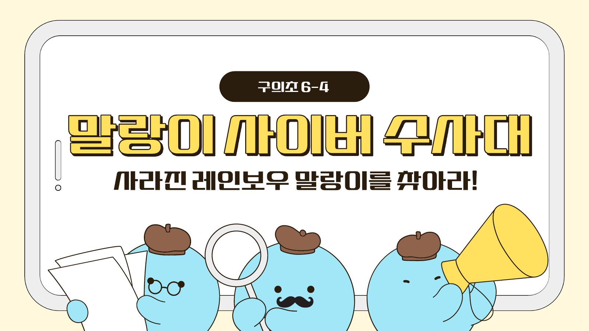](/assets/malang-cyber-security-slide-01.png)

## 2. 기획 배경

사이버보안은 초등학생들에게 다소 어렵고 낯설게 느껴질 수 있는 분야이다.

특히 피싱, 개인정보 유출, 비밀번호 관리와 같은 보안 개념은 일상생활과 밀접하게 연결되어 있지만, 이론적인 설명만으로는 학생들의 관심을 끌거나 개념을 충분히 이해시키기 어렵다고 생각했다.

그래서 학생들이 수동적으로 설명을 듣는 대신, 직접 문제를 발견하고 단서를 분석하며 해결하는 과정에서 보안의 중요성을 느낄 수 있도록 하고 싶었다.

평소 관심이 있었던 CTF의 형식에서 아이디어를 얻었다. CTF는 주어진 환경에서 문제를 분석하고 정답을 찾아가는 방식으로 진행되는데, 이러한 구조를 활용하면 학생들이 게임을 하듯 보안 개념을 학습할 수 있을 것이라고 생각했다.

다만 초등학생 대상 교육이라는 점을 고려하여 복잡한 해킹 기술이나 전문 지식이 없어도 참여할 수 있도록, 웹사이트 탐색과 정보 분석을 중심으로 콘텐츠를 구성했다.

## 3. 콘텐츠 구성 — 사라진 말랑이 연구소 사건

프로젝트 시나리오: 사라진 말랑이 연구소 사건

교육 콘텐츠는 가상의 말랑이 연구소에서 중요한 데이터와 '전설의 말랑이'가 사라진 사건을 배경으로 구성했다.

학생들은 사건을 해결하는 수사관이 되어 여러 웹사이트를 탐색하고, 게시판과 출입 기록, 분실물 및 목격자 정보 등에 숨겨진 단서를 찾아야 한다.

각각의 단서를 분석하여 비밀번호를 추론하거나 필요한 정보를 조합하고, 최종적으로 수사본부에 정답을 제출하는 방식이다.

이를 위해 여러 웹페이지가 하나의 이야기로 연결되는 구조를 기획했다.

[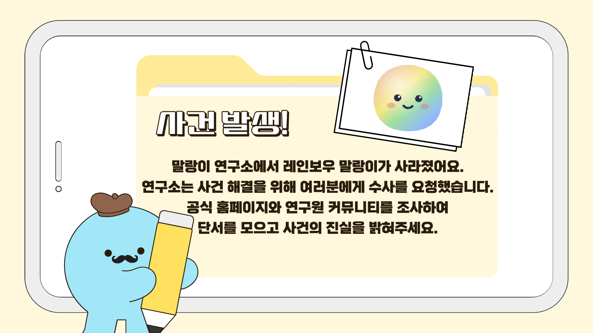](/assets/malang-cyber-security-slide-02.png)

### ① 수사본부 — 문제 확인 및 정답 제출

[https://malang-ctf.vercel.app/hq/](https://malang-ctf.vercel.app/hq/)

학생들이 수사관으로 참여하여 사건을 확인하고 정답을 제출하는 중심 페이지이다.

학생들은 수사본부에서 미션을 확인한 뒤 다른 사이트를 탐색하고, 발견한 단서를 바탕으로 정답을 제출한다.

[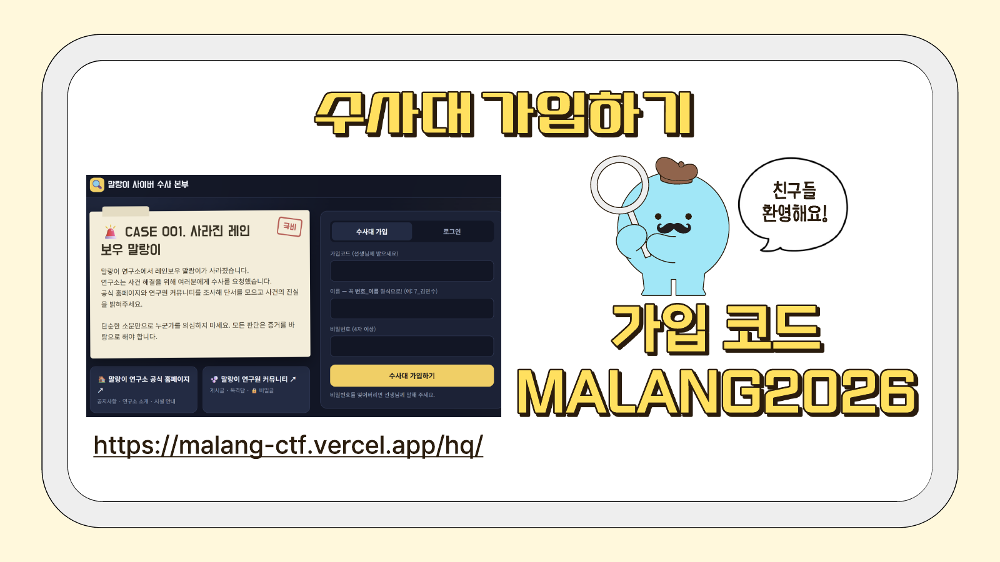](/assets/malang-cyber-security-slide-03.png)

[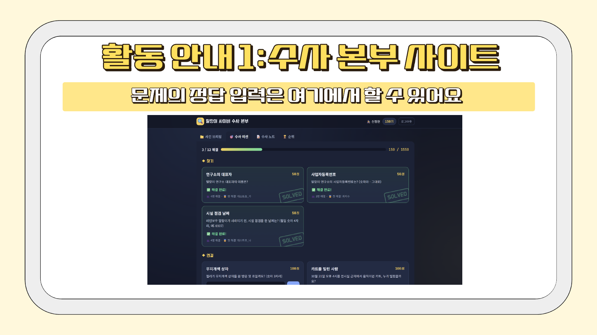](/assets/malang-cyber-security-slide-04.png)

### ② 말랑이 연구소 — 사건의 배경과 단서 탐색

[https://malang-ctf.vercel.app/lab/](https://malang-ctf.vercel.app/lab/)

사건이 발생한 가상의 연구소 홈페이지이다.

연구소 내부 정보와 출입 기록 등 사건과 관련된 자료를 살펴보면서 어떤 정보가 중요한 단서인지 판단하도록 구성했다.

학생들이 단순히 정보를 읽는 것을 넘어, 여러 자료 사이의 연관성을 찾아보도록 하는 것이 목표였다.

### ③ 연구원 커뮤니티 — 게시글과 비밀번호 추론

[https://malang-ctf.vercel.app/community/](https://malang-ctf.vercel.app/community/)

가상의 연구원들이 소통하는 커뮤니티 사이트이다.

게시글에 포함된 정보를 분석하고, 다른 페이지에서 얻은 단서를 조합하여 비밀글의 비밀번호를 추론하도록 했다.

이를 통해 비밀번호와 정보 노출이 어떤 관계를 가질 수 있는지 생각해 볼 수 있도록 구성했다.

[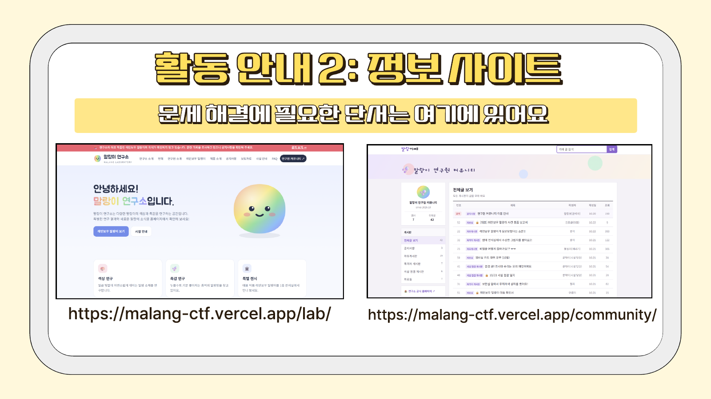](/assets/malang-cyber-security-slide-05.png)

### ④ 실시간 랭킹 — 참여 동기 부여

[https://malang-ctf.vercel.app/rank/](https://malang-ctf.vercel.app/rank/)

학생들의 미션 진행 결과를 확인할 수 있는 실시간 랭킹 페이지이다.

문제를 해결하는 과정에 게임적인 요소를 더해 학생들이 더욱 적극적으로 참여할 수 있도록 활용했다.

### ⑤ 관리자 페이지 — 교육 진행 관리

[https://malang-ctf.vercel.app/admin/](https://malang-ctf.vercel.app/admin/)

교육자가 활동을 운영하고 진행 상황을 관리하기 위한 페이지이다.

학생들이 참여하는 화면과 교육자가 관리하는 화면을 구분하여 실제 수업에서 활용할 수 있는 구조를 마련했다.

[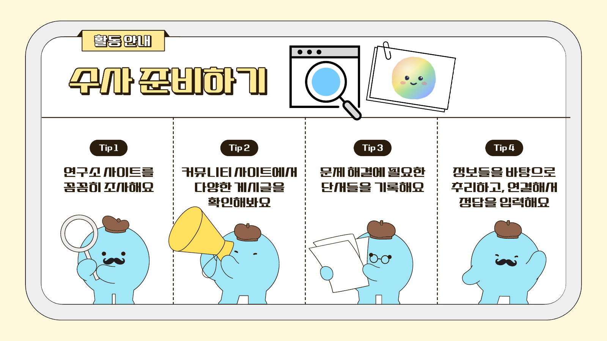](/assets/malang-cyber-security-slide-06.png)

[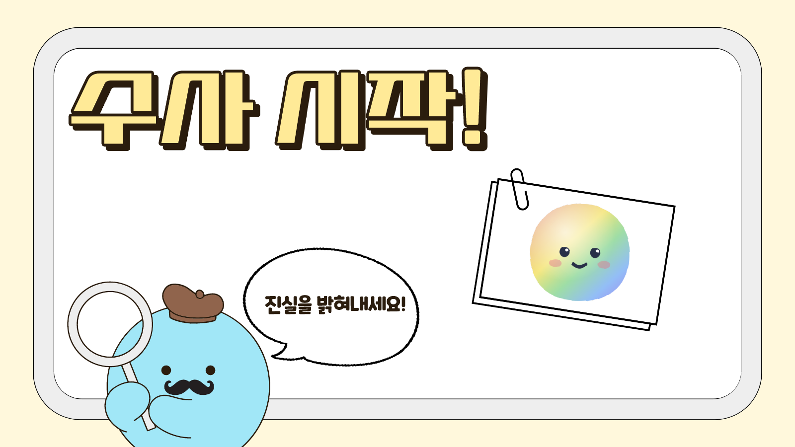](/assets/malang-cyber-security-slide-07.png)

## 4. 교육 과정에서 활용한 보안 개념

이번 콘텐츠에서는 전문적인 취약점 공격 기술보다는 학생들의 일상생활과 밀접하게 연결되는 보안 개념을 중심으로 교육을 구성했다.

**첫 번째는 개인정보 보호이다.**

웹사이트나 게시글에 공개된 정보가 다른 정보와 결합되면 예상하지 못한 내용을 알아낼 수도 있다는 점을 경험하도록 했다.

[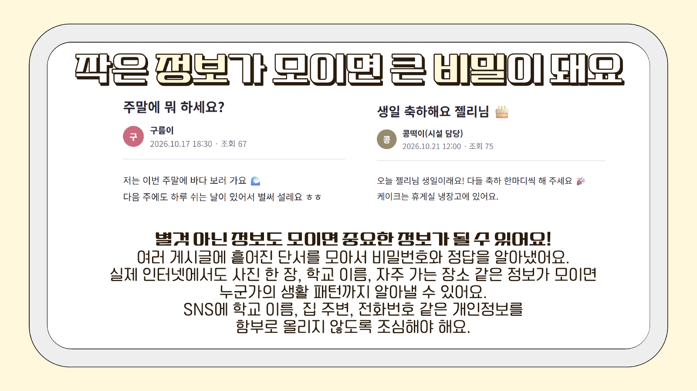](/assets/malang-cyber-security-slide-10.png)

**두 번째는 비밀번호 보안이다.**

여러 단서를 조합하여 비밀번호를 추론하는 활동을 통해, 쉽게 유추할 수 있는 비밀번호를 사용하는 것이 왜 위험할 수 있는지 생각해 보도록 했다.

[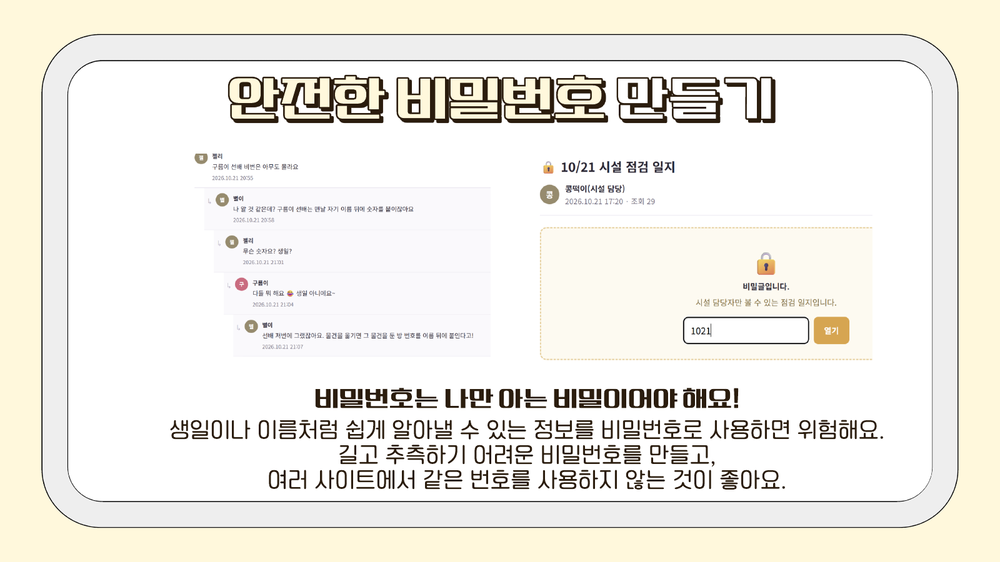](/assets/malang-cyber-security-slide-09.png)

**세 번째는 피싱과 인터넷 안전이다.**

온라인에서 접하는 정보를 무조건 신뢰하기보다는 출처와 내용을 확인하고, 의심스러운 상황을 스스로 판단하는 태도의 중요성을 전달하고자 했다.

[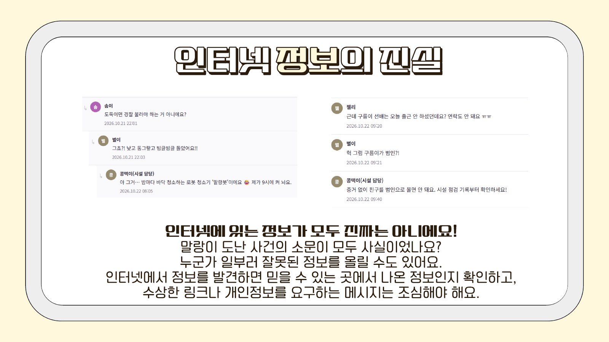](/assets/malang-cyber-security-slide-11.png)

이처럼 학생들이 하나의 사건을 해결하는 과정에서 여러 보안 개념을 자연스럽게 접할 수 있도록 구성했다.

[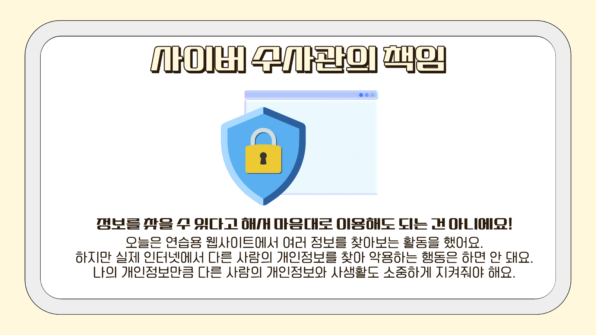](/assets/malang-cyber-security-slide-12.png)

## 5. 프로젝트를 진행하며 느낀 점

이번 활동에서 가장 중요하게 고민했던 부분은 **어려운 보안 개념을 어떻게 학생들이 직접 경험할 수 있는 형태로 바꿀 것인가**였다.

평소에는 보안 기술을 공부하면서 취약점이 발생하는 원리나 이를 탐지하고 해결하는 방법에 관심을 가졌다면, 이번에는 내가 알고 있는 개념을 다른 사람이 이해할 수 있도록 전달하는 방법을 고민해야 했다.

특히 초등학생들을 대상으로 하는 교육이었기 때문에 너무 어려운 개념이나 복잡한 과정을 포함하면 오히려 흥미를 잃을 수 있다고 생각했다.

따라서 복잡한 기술적 설명보다는 하나의 사건을 중심으로 자연스럽게 문제를 해결하도록 구성하고, 그 과정에서 보안 개념을 이해하도록 하는 데 집중했다.

또한 단순히 교육 자료를 만드는 것과 학생들이 직접 사용할 수 있는 웹 콘텐츠를 만드는 것은 다르다는 점도 느꼈다.

학생들이 어떤 순서로 페이지를 탐색할지, 단서를 이해할 수 있을지, 문제를 해결하는 과정에서 흥미를 유지할 수 있을지 등을 함께 고려해야 했기 때문이다.

이러한 과정을 통해 개발에서는 기능을 구현하는 것뿐만 아니라 **누가, 어떤 상황에서, 어떤 목적으로 사용할 것인지를 고려하는 것이 중요하다**는 점을 다시 한번 느꼈다.

무엇보다 평소 공부하던 사이버보안 지식을 다른 사람들의 학습 경험으로 연결할 수 있었다는 점에서 의미가 컸다.

## 6. 아쉬웠던 점과 앞으로의 발전 방향

이번 프로젝트에서는 제한된 교육 시간 안에 학생들이 직접 참여할 수 있는 보안 콘텐츠를 만드는 데 집중했다.

하지만 앞으로 발전시킨다면 학생들의 수준에 따라 난이도를 선택할 수 있도록 하거나, 문제를 해결한 뒤 관련 보안 개념에 대한 해설을 제공하는 기능을 추가해 보고 싶다.

또한 단순히 정답을 맞혔는지 확인하는 것에서 나아가, 학생들이 왜 해당 정보가 보안상 위험할 수 있는지 스스로 이해했는지 확인할 수 있는 평가 방식도 고민해 보고 싶다.

기술적으로는 문제 관리와 정답 검증 구조, 사용자별 진행 상황 관리 등을 더욱 체계적으로 설계해 보고 싶다.

이를 통해 단순히 한 번의 교육에서 사용하는 콘텐츠가 아니라, 다른 교육 환경에서도 활용할 수 있는 보안 학습 플랫폼으로 발전시킬 가능성을 탐색해 보고 싶다.

## 7. 마무리

이번 프로젝트는 단순한 SW 교육 봉사활동을 넘어, 내가 관심을 가지고 공부하고 있는 사이버보안 분야의 지식을 실제 교육 콘텐츠로 연결해 볼 수 있었던 경험이었다.

지금까지는 주로 새로운 기술을 배우거나 주어진 문제를 해결하는 과정에 집중했다면, 이번에는 학생들이 직접 문제를 해결할 수 있는 환경을 만들어 보는 경험을 할 수 있었다.

특히 어렵게 느껴질 수 있는 보안 개념도 적절한 이야기와 활동으로 구성하면 누구나 흥미롭게 접근할 수 있다는 점이 인상 깊었다.

앞으로도 단순히 기술을 배우는 것에서 그치지 않고, **내가 가진 지식과 기술을 활용해 다른 사람에게 도움이 되는 결과물을 만드는 경험**을 계속해 보고 싶다.

[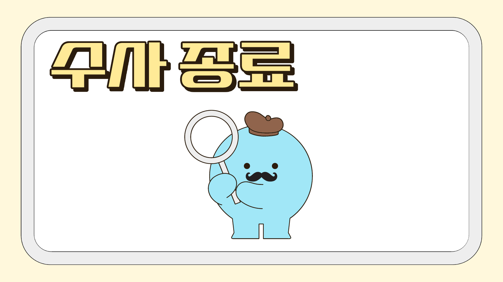](/assets/malang-cyber-security-slide-08.png)
